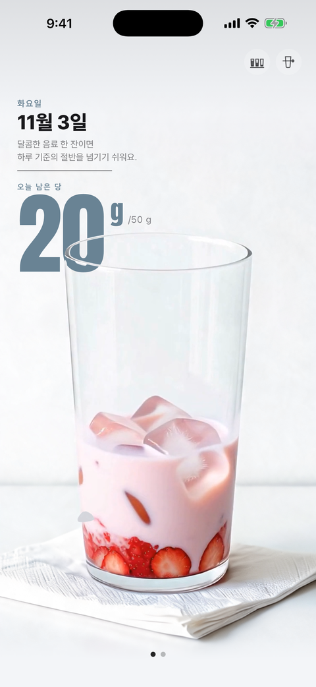
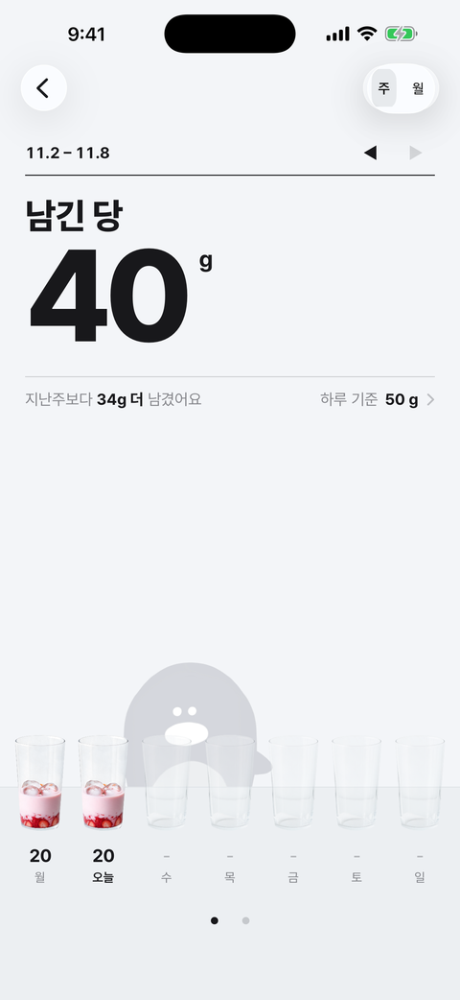
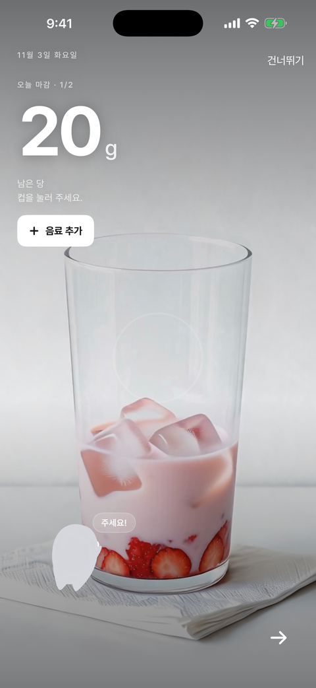

# 슈가캡 SugarCap

당과 카페인을 참는 대신 즐겁게 줄이게 하는 iOS 앱.

하루치 당과 카페인이 담긴 컵이 마실 때마다 줄어들고, 밤에 남은 만큼을 캐릭터 로슈·카인에게 먹여 친해지면서 지난주보다 조금씩 덜 마시게 한다.

<p>
  
  
  
</p>

<p>
  
  
</p>

- App Store: 1.0 심사 중 (2026-11-03 제출, 한국)
- 소개 페이지: https://sugarcap.vercel.app/

## 어떻게 쓰나

1. **기록** — 카페 브랜드 16곳 메뉴 2,057종과 편의점 음료 17,243종을 검색해 한 번에 기록한다. 고르기 전에 "마시면 남는 당이 얼마인지"를 미리 보여 준다.
2. **컵** — 오늘 마실 수 있는 양이 컵 하나에 담겨 있고, 기록할 때마다 그만큼 비워진다.
3. **먹이기** — 밤이 되면 남은 양을 로슈(당)와 카인(카페인)에게 먹여 호감도를 쌓는다. 캐릭터마다 하루 한 번 말을 걸 수 있다.
4. **조금씩 줄이기** — 기준을 지킨 주마다 선물이 오고, 기준은 주마다 서서히 낮아진다.
5. **위젯** — 오늘 남은 양을 홈 화면에서 본다.

서버와 계정이 없다. 기록은 기기에만 남고, 분석 도구와 광고를 넣지 않았다.

## 데이터

카페 메뉴의 당·카페인 수치는 각 브랜드가 공식 홈페이지에 공개한 값을 `tools/scrape/` 파이프라인으로 모은 것이다. 산출물 `data/catalog.json`은 손으로 고치지 않고 파이프라인으로만 만든다. 스키마는 `data/SCHEMA.md`.

## 만든 방법

| 영역 | 도구 |
|---|---|
| 앱 | Swift, SwiftUI, SwiftData, XcodeGen |
| 데이터 수집 | Python 3.13, ruff, mypy, pytest |
| CI | GitHub Actions macOS 러너에서 빌드·단위 테스트·UI 테스트·스토어 스크린샷 |
| 소개 페이지 | 정적 HTML, Vercel |
| 캐릭터 | 직접 그린 원화와 레이어 애니메이션 (`design/assets/characters/`) |

첫 출시는 한국어. 영어·중국어(번체)와 미국·대만 카탈로그는 구현해 두었고 다음 업데이트에 싣는다.

## 폴더

```
SugarCap/      iOS 앱 (XcodeGen 프로젝트)
data/          카탈로그 산출물과 스키마
tools/scrape/  카탈로그 수집 파이프라인
design/        HTML 프로토타입, 화면 흐름, 캐릭터·컵 에셋
site/          소개 페이지 (sugarcap.vercel.app)
docs/          스토어·릴리즈·동의 문구
SPEC.md        제품 스펙 (SSOT)
```

## 사람

기획, 데이터 수집, 캐릭터 원화, 개발, 출시까지 한 사람이 만들었다.
